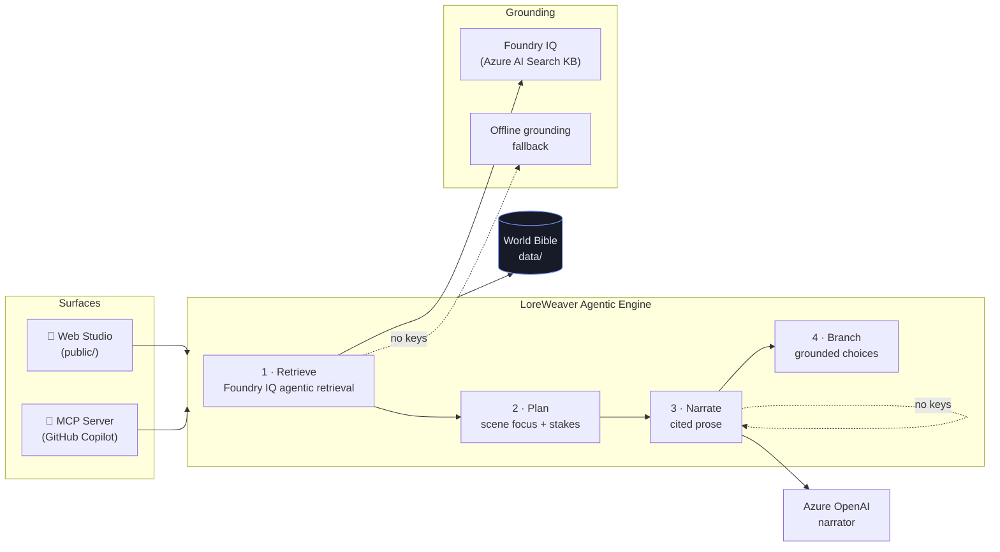

# 🪡 LoreWeaver — Grounded Interactive Storytelling Studio

> **Microsoft Agents League @ AI Skills Fest — Challenge #1: Creative Apps (GitHub Copilot)**

LoreWeaver is a creative app that turns **your own world bible** into **branching, citation-backed interactive fiction**. You author the canon — characters, locations, factions, artifacts, lore — and an agentic engine weaves scenes where **every world fact is grounded in and cited from that canon** using **Foundry IQ agentic retrieval**. The story can never contradict the world it lives in.

It ships as **two surfaces from one engine**:

1. 🎨 A polished **web studio** (story canvas + world bible + live reasoning trace).
2. 🤖 An **MCP server** so you can weave grounded scenes **directly inside GitHub Copilot** (VS Code / Copilot CLI).

---

## ✨ Why this is different

Most AI story generators hallucinate the world as they go, so characters drift and lore contradicts itself. LoreWeaver flips that: it treats your world bible as a **knowledge base** and runs **agentic retrieval** (plan sub-queries → search → rerank → cite) **before** writing a single sentence. The result is **grounded, consistent, citable** fiction — and every claim links back to the exact lore entry that supports it.

This directly answers the challenge's recurring hints: *"grounded context,"* *"trusted knowledge,"* *"consistent memory, knowledge, or relationships."*

---

## 🏆 How it maps to the judging criteria

| Criterion | Weight | How LoreWeaver delivers |
|---|---|---|
| Accuracy & Relevance | 20% | Creative app + **Foundry IQ** + **GitHub Copilot** — all three required pillars, grounded & cited output. |
| Reasoning & Multi-step | 20% | Explicit **4-stage agentic pipeline** (Retrieve → Plan → Narrate → Branch), surfaced live in the UI as a trace. |
| Creativity & Originality | 15% | "Grounded interactive fiction" — combines content generation, interactive experience, and persistent canon memory. |
| User Experience & Presentation | 15% | Atmospheric single-page studio, inline citation chips, branching choices, **+ runs inside Copilot via MCP**. |
| Reliability & Safety | 20% | **Works fully offline** (graceful fallbacks), content-safety + prompt-injection screens, no secrets, input limits. |
| Community vote | 10% | Demo-able in seconds, no API keys required to try. |

> Also targets the **"Best use of IQ tools"** prize via first-class Foundry IQ integration.

---

## 🧩 Required pillars (challenge compliance)

- ✅ **GitHub Copilot** — built end-to-end with Copilot in VS Code (see [`docs/COPILOT_USAGE.md`](docs/COPILOT_USAGE.md)).
- ✅ **Microsoft IQ** — **Foundry IQ** agentic retrieval grounds and cites every scene (see [`src/server/foundryIQ.ts`](src/server/foundryIQ.ts)).
- ✅ **Creative application** — a novel grounded-storytelling studio + Copilot MCP integration.

---

## 🚀 Quick start (no API keys needed)

```bash
npm install
npm run dev
```

Open <http://localhost:4317>. Pick the seed world **"The Sunken Realm of Aethelgard"**, press **✦ Weave the opening**, then follow the branching choices. Hover any `L1` chip to see the cited canon.

> With **zero configuration** LoreWeaver runs in **offline grounding mode**: an in-process agentic-retrieval pipeline over the world bible + a deterministic, grounded narrator. The status pill shows the active mode.

### Go live with Foundry IQ + Azure OpenAI (optional)

```bash
cp .env.example .env
# Fill in FOUNDRY_IQ_* (Azure AI Search agentic retrieval knowledge base)
# and AZURE_OPENAI_* (narration model), then:
npm run dev
```

When configured, retrieval uses your **Foundry IQ knowledge base** and narration uses **Azure OpenAI**. The pipeline shape is identical, so the UX is unchanged — only the grounding source and prose quality improve.

---

## 🤖 Use it inside GitHub Copilot (MCP)

LoreWeaver exposes its engine as an **MCP server**. The repo includes [`.vscode/mcp.json`](.vscode/mcp.json), so in VS Code:

1. Open this folder in VS Code with GitHub Copilot.
2. Start the server from `.vscode/mcp.json` (the **Start** code-lens) or run `npm run mcp`.
3. In Copilot **Agent mode**, ask:
   - *"List the LoreWeaver worlds."*
   - *"Ground the lore about the Dawn Vault and cite sources."*
   - *"Weave the opening scene for the aethelgard world."*

**Tools exposed:** `list_worlds`, `get_world`, `ground_lore`, `weave_scene`, `create_world`, `add_lore`.

---

## 🏗️ Architecture



The same `StoryEngine` powers both surfaces. Grounding and narration each degrade gracefully to an offline path, so the app is always runnable and demo-safe.

---

## 🧠 The agentic pipeline (Reasoning & Multi-step thinking)

Each scene is produced by four explicit stages — visible live in the **Agentic Trace** panel:

1. **Retrieve** — `FoundryIQ.ground()` plans up to 5 sub-queries from the prompt + world, searches the bible, reranks, and returns **cited** passages.
2. **Plan** — turns grounded facts into a scene plan (focus, stakes, title) that *honors existing canon*.
3. **Narrate** — writes prose that may **only assert facts that are cited**, appending `[L#]` markers.
4. **Branch** — derives meaningful choices from the grounded entities (characters, factions, artifacts).

---

## 📂 Project structure

```
LoreWeaver/
├─ src/
│  ├─ server/
│  │  ├─ index.ts        # Express API + static host
│  │  ├─ config.ts       # env config + capability detection
│  │  ├─ foundryIQ.ts    # ⭐ Foundry IQ agentic retrieval (+ offline fallback)
│  │  ├─ storyEngine.ts  # ⭐ 4-stage agentic pipeline
│  │  ├─ narrator.ts     # Azure OpenAI narrator (+ procedural fallback)
│  │  ├─ worldStore.ts   # file-backed world persistence
│  │  └─ safety.ts       # content-safety + prompt-injection screens
│  ├─ mcp/server.ts      # ⭐ MCP server for GitHub Copilot
│  └─ shared/types.ts    # shared domain types
├─ public/               # web studio (index.html, styles.css, app.js)
├─ data/seed/            # seed world bible (Aethelgard)
├─ .vscode/mcp.json      # Copilot MCP connection
└─ docs/                 # architecture + Copilot usage
```

---

## 🔌 API reference

| Method | Path | Purpose |
|---|---|---|
| `GET` | `/api/health` | Capability report (drives live/offline badge). |
| `GET` | `/api/worlds` | List world bibles. |
| `GET` | `/api/worlds/:id` | Get one world bible. |
| `POST` | `/api/worlds` | Create a world (`name`, `premise`, `tone`). |
| `POST` | `/api/worlds/:id/lore` | Add a lore entry. |
| `POST` | `/api/worlds/:id/weave` | Weave the next grounded scene. |

---

## 🔐 Security & safety

- **No secrets in the repo** — all credentials live in `.env` (gitignored); `.env.example` documents them.
- **Content-safety screen** on input *and* output refuses real-world harm while allowing dramatic fiction.
- **Prompt-injection screen** on the MCP/agent surface.
- **Input limits** on every endpoint to prevent abuse.
- Graceful degradation means a missing/failed cloud call **never** crashes a session.

---

## 📜 License

MIT — see headers. Seed world "Aethelgard" is original work created for this submission.
