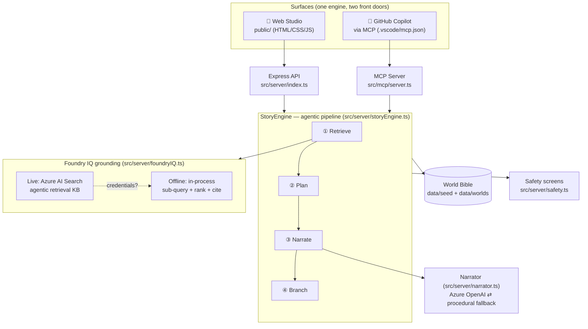
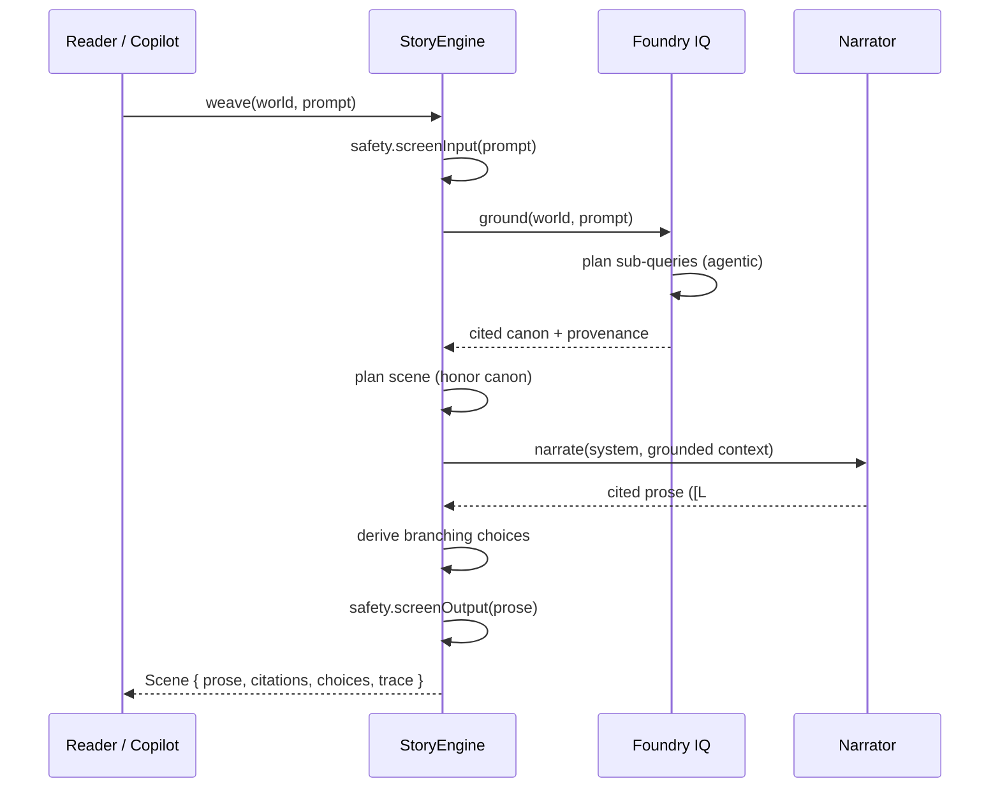

# 🏗️ LoreWeaver Architecture

This document is the architecture diagram + narrative required for submission, showing how the solution uses **Foundry IQ** (Microsoft IQ) and **GitHub Copilot**.

## System overview



## Request lifecycle (weave a scene)



## Design principles

- **Grounded-first.** No world fact is asserted without a retrieved citation.
- **Graceful degradation.** Both the IQ retrieval and the narrator have offline fallbacks, so the app is always runnable (critical for demo + Reliability score).
- **One engine, two surfaces.** Web studio and Copilot MCP share `StoryEngine`, avoiding drift.
- **Transparent reasoning.** The 4-stage trace is a first-class UI element, not a hidden detail.

## Foundry IQ integration points

| Concern | Implementation |
|---|---|
| Knowledge base | World bible (`data/`) → Azure AI Search agentic-retrieval KB when configured. |
| Agentic retrieval | `FoundryIQ.ground()` plans sub-queries, retrieves, reranks, returns citations. |
| Grounded answers w/ citations | `Citation[]` carried through to prose `[L#]` chips and the citations panel. |
| Permission-aware (future) | Live path runs against the KB; can be extended to per-caller Entra identity. |
```
